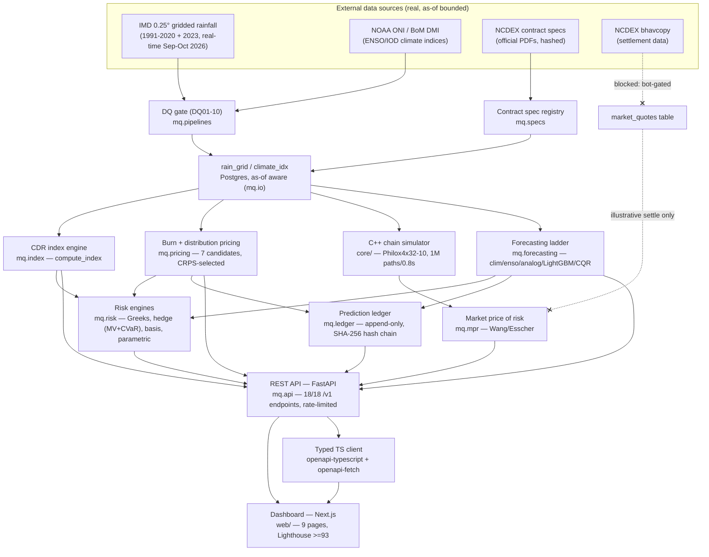

# Architecture

How MonsoonQuant's real pieces connect, end to end: real external data in, a hash-chained public ledger and a dashboard out. No step in this diagram is a stub — every box is backed by real, tested code (`docs/STATUS.md` tracks exactly which milestone built it).

## The one hard rule this diagram enforces

Every arrow flows through the **as-of-aware `mq.io` layer** (`mq.io.asof`) — no computation ever reads data past its own `as_of` date. This is what makes the forecasting ladder's walk-forward backtest honest: a model trained for year *y* structurally cannot see year *y*'s own outcome, enforced in code, not by convention.

## Where the real gaps are (not hidden)

- **`bhavcopy` and MJO are bot-gated** at the source (NCDEX, BoM) and deliberately not worked around — this is why `market_quotes` stays empty and the market price of risk (λ) stays illustrative throughout.
- **The prediction ledger is local-only** — it's real and hash-chain-verified, but SPEC's "public ledger-mirror repo" (a separate, publicly-hosted copy for third-party verification) was never deployed.
- **M14 (cloud deployment) is not started** — everything above runs on `localhost`; there's no public dashboard URL yet.

See `docs/STATUS.md` for the full, current breakdown and `docs/DECISIONS.md` for why the bot-gates were left as policy rather than circumvented.
